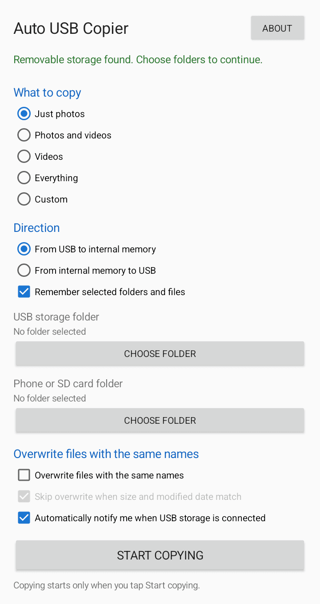

# Auto USB Copier

Auto USB Copier is a lightweight Android app for copying files to and from mounted USB mass-storage devices. It uses Android's Storage Access Framework (SAF), so users explicitly choose the folders the app can read and write.



## Features

- Copy photos and/or videos, all files, or selected custom folders.
- Preserve folder paths.
- Choose USB-to-phone or phone-to-USB direction.
- Avoid overwriting existing files, or overwrite them while skipping files whose sizes and modified dates match.
- Remember selected SAF permissions
- Show a notification when removable USB mass storage is connected.
- Optional debug logging to `Downloads/AutoUsbCopierLog.txt`. Logging contains at most the 100 newest timestamped entries, and does not record filenames.

## Requirements

- Android 5.0 (API 21) or newer. 
- A device with USB host/OTG support, and a USB mass-storage device.
- Android Studio with Android SDK Platform 35, or a local Gradle installation, and JDK 17 (Android Gradle Plugin 8.9.2) for building.

## Build

1. Install Android Studio, JDK 17, and Android SDK Platform 35.
2. Open this repository's root folder in Android Studio and allow Gradle sync to finish.
3. To build and run the unit tests from a terminal with Gradle 8.11.1 (or another version supported by Android Gradle Plugin 8.9.2) installed, run:

   ```text
   gradle testDebugUnitTest
   ```

4. Build the installable debug APK:

   ```text
   gradle assembleDebug
   ```

**The APK is written to `app/build/outputs/apk/debug/app-debug.apk`**. Android Studio can also build it using Build > Build App Bundle(s) / APK(s) > Build APK(s).

## Installation

Install `app-debug.apk` on an Android 5.0+ device. Transfer the APK to the phone and open it (or use ADB). If prompted, allow installation from that file manager or browser in Android settings. 
This debug APK is intended for testing and is signed with a development key; distributing through an app store requires a separately signed release build.

## Usage

1. Connect and mount a USB mass-storage device using the phone's USB host/OTG connection.
2. Open Auto USB Copier. Choose copying mode and direction.
3. Select the USB source/destination folder and the phone or SD-card source/destination folder using Android's folder picker. Grant read/write access. Enable **Remember selected folders and files** if you want to reuse permitted access.
4. For **Custom**, select individual files and/or add folders.
5. Set overwrite preferences, then tap **Start copying**. Copying begins only after this confirmation. 
6. If a media-only scan finds no matching files, choose **Copy everything**, **Choose custom**, or **Cancel**.

The app's notification permission is needed for connection alerts on Android 13 and newer. Denying it does not prevent manual copying. USB detection and background notification delivery depend on the Android device, USB host support, and its storage provider; **another app or system component may handle the USB connection first**.

## Run tests

```text
gradle testDebugUnitTest
```

The local unit tests cover media-extension filtering, overwrite/identical-file policy, and retention of the newest 100 debug-log entries. They do not replace testing SAF permissions, USB hardware, disconnect recovery, or notifications on a physical Android device.

## Project layout

- `app/src/main/java/com/autousbcopier/` — app UI, storage detection, copy service, and file policies.
- `app/src/main/res/` — app strings, themes, and launcher assets.
- `app/src/test/java/com/autousbcopier/` — local JVM unit tests.

## To-do

- Test on more devices focusing on different Android versions, especially with regard to automatic dark mode and notifications
- Make media files detection more robust
- Publish on F-Droid

## Attribution

THIS SOFTWARE COMES WITH ABSOLUTELY NO WARRANTY. Made by MariaWasNotAvailable on GitHub under GPL3 license. Icon based on an image from Flaticon.com.
